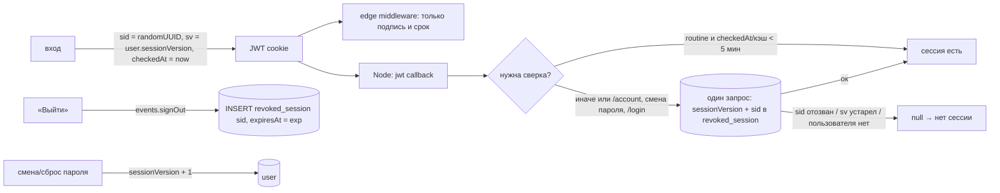

# Design

## Модель

- Токен: `sid` (случайный id сессии), `sv` (версия сессий пользователя на момент выдачи), `checkedAt` (последняя успешная сверка, мс). Поля лежат в зашифрованном JWE, клиент их не подделает.
- `user."sessionVersion" integer not null default 0`. Смена пароля на /account и сброс пароля по ссылке делают `sessionVersion + 1` в том же `UPDATE`, что и новый хеш.
- `revoked_session(sid pk, "userId" → user cascade, "expiresAt" timestamptz)` с индексом по `expiresAt`. Выход вставляет `sid` с `expiresAt = exp` токена и удаляет строки с `expiresAt < now()`: таблица держит только токены, которые ещё могли бы работать. Cron не нужен.
- Имена колонок в стиле схемы (`"userId"`, `"expiresAt"`, `"sessionVersion"`), а не snake_case из черновика задачи.

## Где проверяется

Edge middleware не ходит в базу: оно использует `config.ts` без callbacks (разделение edge/Node уже было) и пропускает любой токен с верной подписью. Сверка — в `jwt` callback Node-конфигурации (`index.ts`): `auth()` в Server Components и Server Actions, `/api/auth/session`, `unstable_update`.

Каждый запрос к базе стоит ~150 мс (T-028), а дашборд делает ~10 последовательных server actions, поэтому обычная сверка throttled:

- токен считается проверенным, если `checkedAt` или запись в памяти инстанса (`sid → userId, sv, checkedAt`, до 5000 записей) моложе 5 минут;
- `checkedAt` в cookie обновляется только там, где Auth.js пишет cookie (`/api/auth/session`, `unstable_update`); `auth()` в Server Components и Server Actions cookie не пишет, поэтому нужен кэш в памяти;
- иначе — один запрос `select "sessionVersion", exists(select 1 from revoked_session where sid = $sid) from "user" where id = $id`.

Немедленная сверка (без окна) через `AsyncLocalStorage`-режим `force` (`authFresh()` / `withSessionCheck('force', …)`): загрузка `/` и `/account`, `changeAccountPassword`, `/login` и `GET /api/auth/session` — зонд, которым клиент T-054 отличает закончившуюся сессию от прочих ошибок (он же — `SessionProvider` при монтировании и фокусе). Загрузок страниц и зондов мало по сравнению с server actions, поэтому один индексированный запрос на каждую допустим. Режим задаёт только серверный код.

Известный инстансу отказ кэшируется: отозванный `sid` (ключ `sid`) и устаревшая версия (ключ `sid:sv`, чтобы не задеть тот же `sid` с принятой новой версией) отвергаются без запроса до истечения токена. Выход на этом инстансе сразу кладёт `sid` в этот кэш.

**Итоговые границы.** Загрузка `/`, `/account`, `/login`, смена пароля и зонд `/api/auth/session` — сразу. Server actions (и `/invite`) — не позже 5 минут с последней успешной сверки токена на инстансе. Открытый дашборд, у которого сессию завершили с другого устройства: первая отвергнутая server action даёт ошибку, клиент зовёт зонд, тот отвечает `null` и чистит cookie, клиент уходит на `/login?callbackUrl=…&reason=session-expired`; до отказа server actions ещё работают не дольше 5 минут.

Отвергнутая server action по-прежнему бросает `Error('Unauthorized')`, и Vercel записывает её как 500 — так же, как раньше для истёкшей сессии мимо middleware. Это теперь возможно только на уже открытой странице, и первая такая ошибка ведёт на вход. Ответ 401 из server action требует `experimental.authInterrupts` и `unauthorized()` во всех 12 helper'ах — отдельная задача.

## Смена пароля и текущая сессия

После `UPDATE` текущий токен тоже устарел. `keepCurrentSessionAfterVersionBump()` вызывает `unstable_update({})` в режиме `adopt-version`: callback сверяется с базой (отозванный `sid` не оживает) и записывает в токен новую `sv`; Server Action пишет новый cookie. Режим недоступен клиенту: `POST /api/auth/session` от `useSession().update()` проходит обычную сверку, а присланные данные сессии в `sv` не попадают, поэтому украденный старый токен так не «обновить».

После Server Action, записавшей cookie, Next.js в том же запросе перерисовывает /account, и `auth()` там читает старую cookie из заголовков запроса (проверено на Preview: без поправки страница уходила на /login и обратно, сообщение «Пароль изменён» терялось). Поэтому инстанс 60 секунд принимает старую версию **этого же** `sid` (`adoptedVersions`); другие токены со старой версией отвергаются сразу.

Если обновление cookie не удалось, пароль всё равно сменён: текущий браузер попросят войти снова.

## /login

Раньше middleware перенаправлял вошедшего с /login на `callbackUrl`. С отозванным токеном это давало бы цикл: /account (Node: нет сессии) → /login (edge: есть сессия) → /account. Теперь перенаправляет сама страница /login после `authFresh()`; middleware /login пропускает. Без cookie `auth()` не вызывает callback и не идёт в базу.

## Сбои и старые токены

- Ошибка базы при сверке — токен принимается без обновления `checkedAt` (следующий запрос проверит снова): кратковременный сбой не выкидывает всех пользователей.
- Ошибка записи в `revoked_session` при выходе: Auth.js логирует `SignOutError` и всё равно чистит cookie.
- Токены без `sid` (выданные до выкладки) не принимаются: один повторный вход для всех вместо бессрочно действующих старых токенов.

## Порядок выкладки

Миграция `0019_session_revocation.sql` применяется к production до merge (стандартный поток). Новый код на старой схеме не работает: запрос сверки упадёт (сессия при этом сохранится по правилу «ошибка базы»), но вход читает `sessionVersion` и падает. Старый код на новой схеме работает: колонка с default и новая таблица ему не мешают.

## Альтернативы

- Database sessions (`strategy: 'database'`) — запрос на каждый `auth()`, ~150 мс × ~10 actions на загрузку дашборда.
- Сверка на каждом запросе без окна — та же цена.
- Короткий срок токена с refresh — меняет решение владельца о 30 днях.
