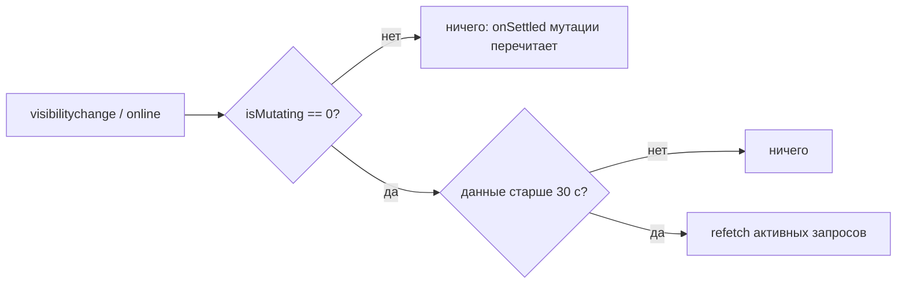

# Design

## Свежесть данных при возврате во вкладку

`createQueryClient()` в `src/shared/api/query-client.ts`:

- `staleTime: 30_000`. Быстрое переключение вкладок не стоит ни одного запроса; возврат через ≥ 30 с перечитывает устаревшие активные запросы. Первичные чтения — ~10 последовательных server actions (~3,9 с, T-028), поэтому порог не ниже 30 с.
- `refetchOnWindowFocus` и `refetchOnReconnect` — функция `() => client.isMutating() === 0`. Пока есть незавершённая мутация (идёт или приостановлена офлайн), refetch не запускается: ответ, прочитанный до записи, перезаписал бы оптимистичную строку. Мутация сама перечитывает свои данные в `onSettled`; остальные устаревшие запросы обновит следующий фокус. Проверка глобальная, а не по ключу: мутации не объявляют, какие ключи они меняют, а операции с pending-id затрагивают несколько сущностей.
- `AppFreshnessController` больше не делает `invalidateQueries` на каждый фокус и reconnect (это был тот самый тяжёлый каскад при каждом переключении). Полное обновление осталось только для смены дня и паузы ≥ 5 мин, тоже без незавершённых мутаций и с `cancelRefetch: false`, чтобы не перезапускать уже идущий refetch.

## Истёкшая сессия

Server action не может сообщить клиенту 401: в production брошенный `Error('Unauthorized')` приходит в браузер обезличенной ошибкой, а middleware отвечал на action без сессии редиректом на HTML `/login`. Поэтому:

- middleware отвечает `401` на запрос с заголовком `next-action` без сессии, а на обычный переход — редиректом на `/login?callbackUrl=<путь>` (для `/` без параметра);
- любая ошибка мутации (`showMutationRollbackToast`) и запроса (`QueryCache.onError`) проходит через `handleRequestFailure`: один `fetch('/api/auth/session')`; истёкшей считается только явная пустая сессия, сетевая ошибка — нет (офлайн не путается с выходом);
- `handleSessionExpired()` срабатывает один раз на страницу: `persistFormDrafts()` в `sessionStorage`, toast «Сессия истекла — войдите снова», `location.assign('/login?callbackUrl=<путь>&reason=session-expired')`; страница входа показывает то же сообщение; общий toast «Не удалось сохранить» не показывается;
- после входа `router.replace(callbackUrl)`; первая смонтированная форма с `useFormDraft` вызывает `restorePersistedFormDrafts()` и удаляет запись из `sessionStorage`.

Форма расхода очищается сразу при отправке (оптимистично), поэтому её содержимое на момент отправки удерживается `holdSubmittedDraft` до успешного сохранения (`addExpense` теперь возвращает `Promise<boolean>`). При истёкшей сессии сохраняется удержанный черновик, если пользователь не начал вводить новый. Остальные формы сохраняют текущие черновики без удержания.

## Офлайн и «Сохраняется…»

Мутации используют `networkMode: 'online'` по умолчанию: `onMutate` выполняется сразу (оптимистичная строка видна), сам запрос приостанавливается до события `online`, затем `resumePausedMutations`. Зависимые операции pending-id ждут id создания как обычно. `NetworkStatus` (в `Providers`) читает `onlineManager` и `useIsMutating()`: офлайн — сообщение сразу, «Сохраняется…» — для приостановленных мутаций сразу и для идущих дольше 1 с. Источник офлайна — события браузера `online`/`offline`; сетевую ошибку отдельного запроса индикатор не учитывает (она откатывается обычным toast).

## Предупреждение при уходе

`UnsavedChangesGuard` вешает `beforeunload`, если `isMutating() > 0` или есть непустое поле, помеченное `useFormDraft(..., { input: true })` (текст, а не выбор сценария или кармана). Отложенные удаления в окне «Отменить» — не мутации и уходят keepalive (ADR 0003), поэтому не учитываются. После `handleSessionExpired` предупреждение молчит.

## Офлайн-сохранение после перезагрузки

OFFLINE_RELOAD_FINDING

## Альтернативы

- Проверять `401` в каждом server action и возвращать код вместо исключения — 13 файлов действий и все вызывающие мутации; проверка сессии после ошибки покрывает все пути одним местом.
- `persistQueryClient` для офлайн-очереди — вне рамок решения владельца.
- Refetch по ключу мутации — мутации не знают своих ключей; глобальная проверка проще и безопаснее.
